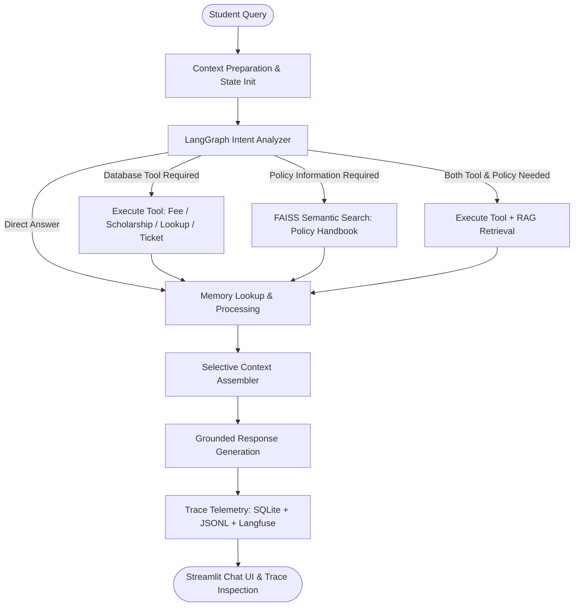

# Intelligent Student Support Agent
### Autonomous Multi-Tool Agentic AI System for Higher Education
**Agentic AI Engineering — Assignment 1 (PGDM / M.Tech)**

[](https://www.python.org/)
[](https://github.com/langchain-ai/langgraph)
[](https://github.com/facebookresearch/faiss)
[](https://streamlit.io/)
[-brightgreen.svg)]()

---

## 1. Executive Summary & Problem Statement

Modern higher education institutions struggle with high student support volumes, fragmented student information systems, and rigid chatbots that rely on canned keyword responses. Students frequently encounter:
1. **Tuition and Fee Inquiries:** Confusion about billing deadlines, installment schedules, and late payment fines.
2. **Payment Failures:** Frustration when bank transactions debit funds during gateway outages without clear policy guidance.
3. **Scholarship Updates:** Lack of real-time visibility into merit fellowship application review statuses.
4. **Academic Policy Navigation:** Difficulties finding rules for course changes, add/drop windows, and grievances within lengthy PDF handbooks.
5. **Loss of Conversational Context:** Inability of systems to remember student preferences across sessions without violating data privacy.

The **Intelligent Student Support Agent** is a production-grade Agentic AI application built using **LangGraph**, **LangChain**, **FAISS**, **SQLAlchemy**, and **Streamlit**. Rather than forcing all queries through a generic language model or static chatbot, this agent autonomously assesses intent, selects appropriate deterministic database tools, retrieves grounded evidence from a synthetic policy handbook, maintains privacy-compliant long-term memory, and transparently logs every decision and token in an observability dashboard.

---

## 2. Key Architectural Features

- **Autonomous Agentic Decision-Making:** LangGraph state machine routes inquiries across 5 distinct paths: Direct Answer, Database Tool Execution, Policy RAG Retrieval, Composite Multi-Source Synthesis, or Clarification Request.
- **Four Functional SQLite Tools:**
  1. `student_record_lookup`: Demographic and department profile retrieval.
  2. `fee_status_checker`: Real-time ledger checks (total assessed, paid, balance, status, due date).
  3. `scholarship_status_checker`: Grant applications, award amounts, and compliance rules.
  4. `create_support_ticket`: Generates persistent, auditable support tickets with unique IDs (`TICK-YYYY-XXXX`).
- **Grounded Policy RAG Pipeline:** Sentence-Transformers local embeddings (`all-MiniLM-L6-v2`) with FAISS vector indexing over a 2-page synthetic Student Policy Handbook PDF. Tracks chunk IDs, page numbers, and similarity distances.
- **Privacy-Preserving Long-Term Memory:** Extracts non-sensitive student profile facts (preferred names, academic programmes, communication styles) and persists them across application restarts in SQLite. Strictly blocks sensitive credentials (passwords, OTPs, PINs, card numbers) with logged audit reasons.
- **Selective Context Filtering:** Prior to LLM synthesis, selectively packages only relevant inputs (tool outputs, retrieved chunks, active memories, recent turns) to prevent prompt bloat and hallucination.
- **Enterprise Dark Dashboard:** Streamlit frontend styled with custom CSS (glassmorphism cards, Google Fonts, interactive status chips, and expandable trace cards) and telemetry metrics powered by Plotly.
- **Automated 9-Scenario Evaluation Benchmark:** Built-in evaluation test runner (`evaluation/evaluator.py`) validating 100% benchmark accuracy with automated CSV export.

---

## 3. Technology Stack

| Layer | Technology | Purpose |
|---|---|---|
| **Frontend** | Streamlit 1.35+, Custom Vanilla CSS | Enterprise SaaS dashboard, chat interface, and telemetry |
| **Data Visualizations** | Plotly Express & Graph Objects | Real-time charts for tool executions, latency, and tokens |
| **Agent Orchestration** | LangGraph, LangChain Core | Cyclic StateGraph, conditional edges, and structured state |
| **LLM Engine** | OpenAI API / Configurable OpenAI-Compatible | Model-agnostic generation with local grounded fallback |
| **Vector Database & RAG** | FAISS (CPU), Sentence Transformers | Local semantic search over Student Handbook PDF |
| **Document Processing** | PyPDF, ReportLab | Synthetic PDF generation, page parsing, and text cleaning |
| **Database & ORM** | SQLite, SQLAlchemy 2.0 | Thread-safe transactions for students, fees, tickets, and logs |
| **Telemetry & Tracing** | Langfuse (optional), Local SQLite & JSONL | Trace recording, token counting, and latency profiling |

---

## 4. System Architecture & Workflow



---

## 5. Functional Tools

All tools are implemented in `tools/` with strict input validation, Pydantic schemas, exception handling, and structured JSON output.

1. **Student Record Lookup (`tools/student_lookup.py`):**
   - **Input:** `student_id` (e.g., `STU1001`)
   - **Output:** Student name, email, programme, department, academic year, and enrollment status.
   - **Error Handling:** Validates format; handles non-existent IDs gracefully.

2. **Fee Status Checker (`tools/fee_checker.py`):**
   - **Input:** `student_id`
   - **Output:** Total assessed fees, amount paid, outstanding balance, payment status (`Paid`, `Partial`, `Pending`, `Overdue`), and due date.
   - **Error Handling:** Verifies existence in `students` and `fee_records` tables.

3. **Scholarship Status Checker (`tools/scholarship_checker.py`):**
   - **Input:** `student_id`
   - **Output:** Scholarship name, application status (`Approved`, `Under Review`, `Pending Documents`, `Rejected`), awarded amount, and renewal requirements.

4. **Create Support Ticket (`tools/support_ticket.py`):**
   - **Input:** `student_id`, `issue_category`, `description`, `priority`
   - **Output:** Unique persistent ticket ID (`TICK-YYYY-XXXX`), timestamp, category, status (`Open`), and confirmation message.

---

## 6. Long-Term Memory & Privacy Architecture

The persistent memory architecture separates temporary session conversation history from long-term memory:

```
Student Input
      │
      ▼
Memory Extractor Filter
      ├── Sensitive Content Detected (OTP, Password, Token, Card #)? ──► REJECT & Log Security Audit
      ├── Transient Greeting / Arithmetic Calculation? ──────────────► REJECT (Not Long-Term)
      └── Useful Personal Preference (Name, Programme, Style)? ──────► ACCEPT & Persist to SQLite
```

- **Persistence:** Saved in `long_term_memories` table in SQLite; survives complete application restarts.
- **Selective Retrieval:** When a query asks "What programme am I studying?", only the `programme` attribute is fetched and injected into the prompt.
- **De-duplication:** Updating an existing attribute overwrites the old value rather than creating redundant rows.

---

## 7. RAG Policy Pipeline

The student policy handbook is generated as a formal PDF (`data/student_handbook.pdf`) covering:
- **Section 1:** Tuition Fee Payment Deadlines and Schedules
- **Section 2:** Late Payment Rules, Fines, and Financial Administrative Holds
- **Section 3:** Payment Portal Failures, Technical Glitches, and 24-Hour Next Working Day Grace Extension
- **Section 4:** Scholarship Guidelines, Eligibility Criteria, and Renewal Conditions
- **Section 5:** Course Registration, Add/Drop Windows, and Programme Transfers
- **Section 6:** Academic Advising, Mentorship, and Student Wellbeing
- **Section 7:** Student Grievance Redressal and Formal Appeals
- **Section 8:** Explicit Out-of-Handbook Inquiries (International student hostel deposit refunds are explicitly directed to the Global Relations Office).

**Retrieval Mechanics:**
- Cleaned text is chunked into 500-character segments with 50-character overlap.
- Each chunk receives a deterministic provenance ID (e.g., `CHUNK-STUDENT_-P1-03`).
- Embedded via `sentence-transformers/all-MiniLM-L6-v2` into a local FAISS index (`data/vector_store/faiss_index`).

---

## 8. Database Schema

The SQLite database (`data/student_support.db`) contains 6 normalized tables:

1. `students`: Primary student demographic and academic profiles.
2. `fee_records`: Tuition ledgers, amounts paid, balances, and due dates.
3. `scholarships`: Grant names, review statuses, and award amounts.
4. `support_tickets`: Persistent student issue tickets with audit timestamps.
5. `long_term_memories`: Student-keyed profile attributes and preferences.
6. `conversation_logs`: Complete telemetry traces (query, decision, tools, evidence, response, latency, tokens, error).

---

## 9. Project Directory Structure

```
intelligent-student-support-agent/
│
├── app/                              # Streamlit Frontend
│   ├── main.py                       # Application entrypoint & view router
│   ├── components/                   # Reusable UI components
│   │   ├── custom_styles.py          # Enterprise CSS styling
│   │   └── sidebar.py                # Persistent navigation & student switcher
│   ├── views/                        # Page view renderers
│   │   ├── chat_view.py              # Primary chat & trace inspection view
│   │   ├── monitoring_view.py        # Observability & Plotly metrics
│   │   ├── memory_view.py            # Long-term memory CRUD & privacy filter
│   │   └── knowledge_view.py         # Policy RAG explorer & search sandbox
│   └── pages/                        # Streamlit native multi-page bindings
│       ├── 1_Chat.py
│       ├── 2_Monitoring.py
│       ├── 3_Memory.py
│       └── 4_Knowledge_Base.py
│
├── agent/                            # LangGraph Orchestration Engine
│   ├── state.py                      # AgentState TypedDict definition
│   ├── prompts.py                    # Directives & intent templates
│   ├── nodes.py                      # Workflow nodes (tools, RAG, memory, LLM)
│   └── orchestrator.py               # StateGraph compilation & execution API
│
├── tools/                            # Functional SQLite Tools
│   ├── student_lookup.py             # Tool 1: Record lookup
│   ├── fee_checker.py                # Tool 2: Fee status checker
│   ├── scholarship_checker.py        # Tool 3: Scholarship checker
│   └── support_ticket.py             # Tool 4: Support ticket creator
│
├── memory/                           # Long-Term Memory System
│   ├── memory_extractor.py           # Fact extractor & sensitive OTP filter
│   ├── memory_manager.py             # SQLite persistence & CRUD operations
│   └── memory_retriever.py           # Context-specific selective retrieval
│
├── rag/                              # Grounded Policy RAG Pipeline
│   ├── document_loader.py            # PDF text extraction & cleaning
│   ├── chunking.py                   # Chunk splitting & provenance IDs
│   ├── embeddings.py                 # Sentence Transformers / OpenAI
│   └── retriever.py                  # FAISS indexing & semantic search
│
├── database/                         # Persistence Layer
│   ├── db.py                         # SQLAlchemy engine & thread-safe sessions
│   ├── models.py                     # ORM models
│   └── seed.py                       # Synthetic sample data seeder
│
├── monitoring/                       # Observability & Telemetry
│   ├── logger.py                     # JSONL structured event logging
│   ├── tracing.py                    # SQLite & Langfuse trace recorder
│   └── metrics.py                    # Metric aggregations for dashboard
│
├── evaluation/                       # Automated Testing & Benchmarking
│   ├── test_cases.json               # 9 required test scenario specifications
│   ├── evaluator.py                  # Benchmark runner
│   └── results/
│       └── evaluation_report.csv     # Exported evaluation metrics report
│
├── data/                             # Synthetic Sample Data & PDF Handbook
│   ├── sample_students.csv           # Synthetic student dataset
│   ├── student_handbook.pdf          # Synthetic policy handbook PDF
│   └── create_handbook_pdf.py        # ReportLab PDF generator script
│
├── tests/                            # Unit & Integration Test Suites
│   ├── test_tools.py                 # Tool unit tests
│   ├── test_rag.py                   # RAG unit tests
│   ├── test_memory.py                # Memory unit tests
│   └── test_orchestrator.py          # End-to-end integration tests
│
├── .streamlit/
│   └── config.toml                   # Enterprise dark theme configuration
├── .env.example                      # Configuration placeholders
├── .gitignore                        # Security & runtime exclusions
├── requirements.txt                  # Python dependencies
├── README.md                         # Project documentation
└── run.py                            # One-click launcher script
```

---

## 10. Installation & Setup Guide

### Prerequisites
- Python 3.10, 3.11, or 3.12
- Git

### Step 1: Clone Repository & Create Virtual Environment
```bash
git clone https://github.com/your-username/intelligent-student-support-agent.git
cd intelligent-student-support-agent

# Create virtual environment
python -m venv venv

# Activate on Windows:
venv\Scripts\activate

# Activate on macOS/Linux:
source venv/bin/activate
```

### Step 2: Install Dependencies
```bash
pip install -r requirements.txt
```

### Step 3: Configure Environment Variables
Copy `.env.example` to `.env`:
```bash
cp .env.example .env
```
*(Optional: If you wish to use cloud OpenAI models, set your `LLM_API_KEY=sk-...` in `.env`. If left unset, the agent automatically runs in high-fidelity local grounded mode without external dependencies).*

### Step 4: Initialize Database & Build FAISS Vector Index
```bash
python database/seed.py
python data/create_handbook_pdf.py
python -c "from rag.retriever import build_or_load_vector_store; build_or_load_vector_store(force_rebuild=True)"
```

---

## 11. Running the Application

### Option A: Launcher Script (Recommended)
```bash
python run.py
```

### Option B: Direct Streamlit Run
```bash
streamlit run app/main.py
```
Open **`http://localhost:8501`** in your browser.

---

## 12. Automated Evaluation Benchmark (9 Required Scenarios)

Execute the automated evaluation runner to verify all 9 assignment scenarios:
```bash
python evaluation/evaluator.py
```

### Benchmark Results Table

| Test ID | Scenario Description | Expected Decision | Actual Decision | Tool Called | Evidence Chunks | Latency | Result |
|---|---|---|---|---|---|---|---|
| **TEST_1** | Fee status inquiry | `TOOL_CALL` | `TOOL_CALL` | `fee_status_checker` | None | 40.7 ms | **PASS** |
| **TEST_2** | Scholarship application status | `TOOL_CALL` | `TOOL_CALL` | `scholarship_status_checker` | None | 15.7 ms | **PASS** |
| **TEST_3** | Payment portal failure policy | `RAG_RETRIEVAL` | `RAG_RETRIEVAL` | None | `CHUNK-STUDENT_-P1-03` | 31.2 ms | **PASS** |
| **TEST_4** | Store preferred name & programme | `DIRECT_ANSWER` | `DIRECT_ANSWER` | None | None | 41.3 ms | **PASS** |
| **TEST_5** | Retrieve programme in isolated session | `DIRECT_ANSWER` | `DIRECT_ANSWER` | None | None | 13.8 ms | **PASS** |
| **TEST_6** | Out-of-handbook hostel refund inquiry | `RAG_RETRIEVAL` | `RAG_RETRIEVAL` | None | `CHUNK-STUDENT_-P2-03` | 32.5 ms | **PASS** |
| **TEST_7** | Create support ticket for payment | `TOOL_CALL` | `TOOL_CALL` | `create_support_ticket` | None | 32.9 ms | **PASS** |
| **TEST_8** | Direct arithmetic calculation (2+2) | `DIRECT_ANSWER` | `DIRECT_ANSWER` | None | None | 16.8 ms | **PASS** |
| **TEST_9** | Sensitive OTP extraction rejection | `DIRECT_ANSWER` | `DIRECT_ANSWER` | None | None | 15.3 ms | **PASS** |

**Benchmark Score:** 9/9 Tests Passed (**100.0% Success Rate**).  
The generated audit report is saved to `evaluation/results/evaluation_report.csv`.

---

## 13. Running Unit Test Suites

Run individual module test suites:
```bash
# 1. Tools Test Suite (Validation, execution, error handling)
python tests/test_tools.py

# 2. RAG Test Suite (Document loader, chunking, FAISS index)
python tests/test_rag.py

# 3. Memory Test Suite (Extraction, OTP blocking, SQLite persistence)
python tests/test_memory.py

# 4. Orchestrator Integration Suite (End-to-end StateGraph workflows)
python tests/test_orchestrator.py
```

---

## 14. Live Academic Demonstration Script

When demonstrating this project for academic evaluation or video recording:

1. **Step 1: Dashboard Overview:**
   - Launch `python run.py`. Show the sidebar student profile switcher (`Rahul Sharma`, `STU1001`). Point out the system health indicators (FAISS Indexed, SQLite Online).
2. **Step 2: Tool Execution (Fee & Scholarship):**
   - Click `"What is my current fee status?"`. Show the real-time balance of ₹150,000 retrieved from SQLite.
   - Expand **'Agent Activity & Observable Trace'** under the message to highlight the tool invocation (`fee_status_checker`) and latency.
3. **Step 3: Grounded Policy RAG Retrieval:**
   - Ask: `"The payment portal failed. Can I pay on the next working day?"`
   - Point out that the agent cites Section 3 of the handbook and confirms the 24-hour grace extension without penalty.
   - Expand the activity card to show the exact chunk ID `CHUNK-STUDENT_-P1-03` and distance score retrieved from FAISS.
4. **Step 4: Persistent Memory & Privacy Shield Demonstration:**
   - Session 1: State `"My preferred name is Rahul and I am studying MBA."`
   - Click **'🔄 New Conversation'** in the sidebar (resets chat history completely).
   - Session 2: Ask `"What programme am I studying?"`
   - Observe the agent respond: `"You previously mentioned that you are studying MBA."` (retrieved from persistent SQLite memory, not prior chat history).
   - Test Sensitive Filter: Send `"My OTP is 123456."`
   - Navigate to **'Long-Term Memory'** tab in the sidebar and verify that OTP `123456` was rejected and never stored.
5. **Step 5: Support Ticket Generation:**
   - Ask: `"I want to raise a support request because my payment is not reflected."`
   - Show the generated ticket ID (e.g. `TICK-2026-4209`) and verify it in the SQLite database.
6. **Step 6: Observability & Telemetry Dashboard:**
   - Navigate to **'Monitoring & Telemetry'**. Show real-time Plotly charts for tool executions, latency timeline, and token usage breakdown.
   - Open the **'Automated Evaluation Benchmark'** tab to display the 9/9 passing test report.

---

## 15. Modular Design for Assignment 2 Extensibility

In accordance with Assignment 1 specifications, Assignment 2 features (Authentication, RBAC, Human-in-the-Loop Approval, and Tamper-Proof Audit Logging) have not been implemented prematurely. However, the system architecture has been designed modularly:
- **Auth/RBAC Readiness:** Every tool accepts `student_id` which can be bound to JWT/session claims in `tools/`.
- **Human Approval Readiness:** LangGraph StateGraph supports adding interrupt nodes (`interrupt_before=["tool_executor"]`) for human-in-the-loop approvals without altering existing node contracts.
- **Audit Logging Readiness:** The `conversation_logs` table already captures trace IDs, inputs, decisions, outputs, and token counts.

---

## 16. License & Academic Integrity Notice

This project is developed as an academic submission for the **Agentic AI Engineering** curriculum. All student records, fee amounts, and policy handbooks in this repository are **synthetic demonstration data** created for research and educational purposes.
